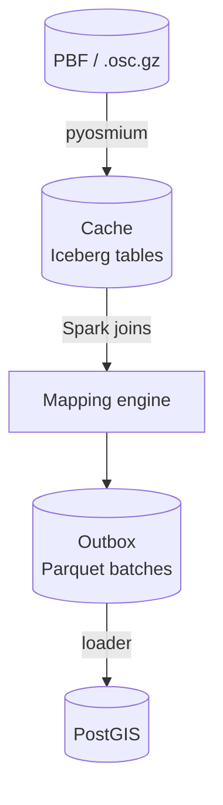

# osm-spark-import

Imports OpenStreetMap into PostgreSQL/PostGIS with Spark: an initial
import from a planet (or extract) PBF, then incremental updates from
replication diffs (minutely, hourly, daily). A mapping file decides which
tables are created and what goes into them.



- **pyosmium** decodes PBF chunks and change files in Spark tasks.
- **Spark** keeps the cache (nodes, ways, relations, reference indexes) as
  Iceberg tables and assembles each element with what its rows need.
- The **mapping engine** (`osm_spark_import.mapping`) applies the
  [mapping file](docs/mapping.md): tag filters, matching, geometries, column
  values, expired tiles.
- Every import and every diff run writes a **batch** of Parquet files to
  storage (HDFS); **osm-spark-import-loader** applies batches to PostgreSQL in
  order, each in one transaction.

Design: [docs/design.md](docs/design.md). Mapping format: [docs/mapping.md](docs/mapping.md).

## Local cluster

Docker Compose: HDFS (namenode, datanode), Spark standalone (master, two
workers), PostGIS, the loader and a `client` container for the jobs. Images
build for amd64 and arm64.

```sh
docker compose up -d --build
docker compose run --rm client osm-spark-import chunk https://download.geofabrik.de/europe/andorra-latest.osm.pbf hdfs://namenode:8020/osm/pbf/andorra
docker compose run --rm client osm-spark-import import hdfs://namenode:8020/osm/pbf/andorra
docker compose logs -f loader                       # snapshot -> schema import
docker compose run --rm client osm-spark-import-loader deploy
docker compose run --rm client osm-spark-import run       # diffs since; the loader applies them to public
psql -h localhost -U osm osm                        # password osm
```

Defaults: [mappings/default.yml](mappings/default.yml), Andorra's daily
diffs from Geofabrik, expired tiles at zoom 15 in `./data/expire`. Geofabrik
keeps dated extracts of the last days (`andorra-YYMMDD.osm.pbf`): import one
from a few days ago to have diffs to apply. UIs: HDFS http://localhost:9870,
Spark http://localhost:18080. Reset: `docker compose down -v`.

## Commands

| | |
|---|---|
| `osm-spark-import chunk SOURCE DEST [--chunk-mb N \| --chunks N] [--md5 H] [--sequence N] [--force]` | PBF (path or URL) streamed into PBF chunks in storage, MD5 checked, no Spark. Replication continues from the sequence of the PBF's timestamp, unless given |
| `osm-spark-import import CHUNKS [--sequence N]` | chunks → cache → snapshot batch |
| `osm-spark-import run [--loop] [--max-diffs N] [--until SEQ]` | replication diffs → delta batches (`--loop` only for the docker setup) |
| `osm-spark-import rebuild` | snapshot batch from the cache (after a mapping change), then deploy it |
| `osm-spark-import maintain` | compact the cache tables, expire old snapshots, remove orphan files (e.g. daily) |
| `osm-spark-import unlock` | remove the writer lock of a run that is gone |
| `osm-spark-import status` | writer state, lock, replication lag, last batch, approximate cache sizes |
| `osm-spark-import-loader [apply] [--loop]` | snapshot batches → schema `import`; delta batches → production, once their snapshot is deployed |
| `osm-spark-import-loader deploy` | `import` → production → `backup` |
| `osm-spark-import-loader revert-deploy` / `remove-backup` | back to the previous tables / drop them |
| `osm-spark-import-loader clean` | delete outbox batches no schema needs (also done after every change) |
| `osm-spark-import-loader status` | batch, sequence and time of each schema, lag |
| `osm-spark-import-compare A B` | compare the tables of two schemas |

Tables in production are replaced by `deploy` only, so checks and extra
indexes can run on schema `import` first. The loader keeps its state in
schema `osm_spark_import`; the production schema holds only the mapping's tables.
Expired tiles are written as `DIR/YYYYMMDD/HHMMSS.mmm.tiles` (`z/x/y` lines).

The commands that change the cache or the outbox (`import`, `rebuild`,
`run`, `maintain`) hold a lock per namespace (`<root>/state/<namespace>.lock`).
A later attempt of the same Spark application takes it over; any other run
fails until `unlock`.

## Settings

| Variable | Default | |
|---|---|---|
| `OSM_MAPPING` | — | mapping file (YAML/JSON) |
| `OSM_SRID` | `3857` | 3857 or 4326 |
| `OSM_NAMESPACE` | `osm` | one per import: cache tables, outbox, state |
| `OSM_CATALOG`, `OSM_STORAGE_ROOT` | `osm`, `hdfs://namenode:8020/osm` | Iceberg catalog; where the outbox, staging, state and lock live |
| `OSM_BUCKETS`, `OSM_PARTITIONS` | `16`, `spark.sql.shuffle.partitions` | cache table buckets (planet: hundreds); build partitions (set it on clusters) |
| `OSM_CHUNK_MB` | `32` | default chunk size of `chunk` (one decode task each) |
| `OSM_BIG_UNIT_NODES` | `100000` | work units (large relations) with more coordinates are built apart, one at a time, and logged |
| `OSM_SNAPSHOT_RETENTION_HOURS` | `24` | `maintain` expires older cache snapshots |
| `OSM_REPLICATION_URL`, `OSM_MAX_DIFFS` | planet minutely, `24` | |
| `OSM_EXPIRE_ZOOM`, `OSM_EXPIRE_DIR` | `15`, off | writer computes tiles; loader writes the files |
| `OSM_WEBHDFS_URL`, `OSM_WEBHDFS_USER`, `OSM_WEBHDFS_KERBEROS` | off, —, `false` | loader and `chunk`: hdfs:// over WebHDFS (Kerberos: `pip install '.[kerberos]'`); off: fsspec on the URI (libhdfs, s3, gs, ...) |
| `OSM_SCHEMA`, `OSM_SCHEMA_IMPORT`, `OSM_SCHEMA_BACKUP` | `public`, `import`, `backup` | loader |
| `OSM_LOADER_WORKERS` | `4` | parallel COPY for snapshots |
| `PGHOST`, `PGUSER`, ... | | loader: the database (libpq; prefer `PGPASSFILE` or a secret to `PGPASSWORD`) |

## Tests

Unit tests run in the image build: mapping file, filters,
matchers, column values, geometries and multipolygons, tile lists, chunking,
settings, SQL, CSV for COPY, loader. `tests/test_spark_pipeline.py` runs the
Spark side in local mode with an Iceberg catalog in a temporary directory
(chunk, import, diffs against a fresh import, crash recovery, lock,
maintenance); it needs Java and the Iceberg runtime JAR, and is skipped
without them:

```sh
OSM_TEST_ICEBERG_JAR=/path/to/iceberg-spark-runtime-3.5_2.12-1.6.1.jar python -m pytest tests
docker compose run --rm client sh -c 'cd /opt/osm-spark-import && python -m pytest tests'
```

End to end, an import plus diffs must give the same tables as an import of
the newer data ([docs/design.md](docs/design.md#6-verification)).

## Acknowledgements

Influenced by [imposm3](https://github.com/omniscale/imposm3) (Apache License
2.0). The mapping engine and its tests are derived from it; see
[NOTICE](NOTICE).

## License

Apache License 2.0: [LICENSE](LICENSE).
