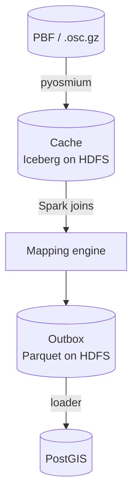

# osm-hadoop-import

Imports OpenStreetMap into PostgreSQL/PostGIS through Hadoop: an initial
import from a planet (or extract) PBF, then incremental updates from
replication diffs (minutely, hourly, daily). A mapping file decides which
tables are created and what goes into them.



- **pyosmium** decodes PBF chunks and change files in Spark tasks.
- **Spark** keeps the cache (nodes, ways, relations, reference indexes) as
  Iceberg tables on HDFS and assembles each element with what its rows need.
- The **mapping engine** (`osm_hadoop.mapping`) applies the
  [mapping file](docs/mapping.md): tag filters, matching, geometries, column
  values, expired tiles.
- Every import and every diff run writes a **batch** of Parquet files on
  HDFS; **osm-hadoop-loader** applies batches to PostgreSQL in order, each in
  one transaction.

Design: [docs/design.md](docs/design.md). Mapping format: [docs/mapping.md](docs/mapping.md).

## Local cluster

Docker Compose: HDFS (namenode, datanode), Spark standalone (master, two
workers), PostGIS, the loader and a `client` container for the jobs. Images
build for amd64 and arm64.

```sh
docker compose up -d --build
docker compose run --rm client osm-hadoop import https://download.geofabrik.de/europe/andorra-latest.osm.pbf
docker compose logs -f loader                       # snapshot -> schema import
docker compose run --rm client osm-hadoop-loader deploy
docker compose run --rm client osm-hadoop run       # diffs since; the loader applies them to public
psql -h localhost -U osm osm                        # password osm
```

Defaults: [mappings/default.yml](mappings/default.yml), Andorra's daily
diffs from Geofabrik, expired tiles at zoom 15 in `./data/expire`. Geofabrik
keeps dated extracts of the last days (`andorra-YYMMDD.osm.pbf`): import one
from a few days ago to have diffs to apply. UIs: HDFS http://localhost:9870,
Spark http://localhost:18080. Reset: `docker compose down -v`.

## Commands

| | |
|---|---|
| `osm-hadoop import PBF [--sequence N]` | PBF (path or URL) → cache → snapshot batch. Replication continues from the sequence of the PBF's timestamp, unless given |
| `osm-hadoop run [--loop] [--max-diffs N] [--until SEQ]` | replication diffs → delta batches |
| `osm-hadoop rebuild` | snapshot batch from the cache (after a mapping change), then deploy it |
| `osm-hadoop status` | writer state, last batch, cache sizes |
| `osm-hadoop-loader [apply] [--loop]` | snapshot batches → schema `import`; delta batches → production, once their snapshot is deployed |
| `osm-hadoop-loader deploy` | `import` → production → `backup` |
| `osm-hadoop-loader revert-deploy` / `remove-backup` | back to the previous tables / drop them |
| `osm-hadoop-loader status` | batch, sequence and time of each schema |
| `osm-hadoop-compare A B` | compare the tables of two schemas |

Tables in production are replaced by `deploy` only, so checks and extra
indexes can run on schema `import` first. The loader keeps its state in
schema `osm_hadoop`; the production schema holds only the mapping's tables.
Expired tiles are written as `DIR/YYYYMMDD/HHMMSS.mmm.tiles` (`z/x/y` lines).

## Settings

| Variable | Default | |
|---|---|---|
| `OSM_MAPPING` | — | mapping file (YAML/JSON) |
| `OSM_SRID` | `3857` | 3857 or 4326 |
| `OSM_NAMESPACE` | `osm` | one per import: cache tables, outbox, state |
| `OSM_CATALOG`, `OSM_HDFS_ROOT` | `osm`, `hdfs://namenode:8020/osm` | Iceberg catalog; outbox, staging and state |
| `OSM_BUCKETS`, `OSM_PARTITIONS`, `OSM_CHUNK_MB` | `16`, Spark's parallelism, `32` | cache table buckets (planet: hundreds); build partitions; PBF chunk size (one decode task each) |
| `OSM_REPLICATION_URL`, `OSM_MAX_DIFFS` | planet minutely, `24` | |
| `OSM_EXPIRE_ZOOM`, `OSM_EXPIRE_DIR` | `15`, off | writer computes tiles; loader writes the files |
| `OSM_WEBHDFS_URL`, `OSM_WEBHDFS_USER` | `http://namenode:9870` | loader: how to read the outbox |
| `OSM_SCHEMA`, `OSM_SCHEMA_IMPORT`, `OSM_SCHEMA_BACKUP` | `public`, `import`, `backup` | loader |
| `OSM_LOADER_WORKERS` | `4` | parallel COPY for snapshots |
| `PGHOST`, `PGUSER`, ... | | loader: the database (libpq) |

## Tests

Unit tests run in the image build (196: mapping file, filters, matchers,
column values, geometries and multipolygons, ring merging, tile lists, PBF
splitting, SQL, CSV for COPY):

```sh
docker compose run --rm client sh -c 'cd /opt/osm-hadoop/jobs && python -m pytest tests'
```

End to end, an import plus diffs must give the same tables as an import of
the newer data ([docs/design.md](docs/design.md#6-verification)).

## Acknowledgements

Influenced by [imposm3](https://github.com/omniscale/imposm3) (Apache License
2.0). The mapping engine and its tests are derived from it; see
[NOTICE](NOTICE).

## License

Apache License 2.0: [LICENSE](LICENSE).
