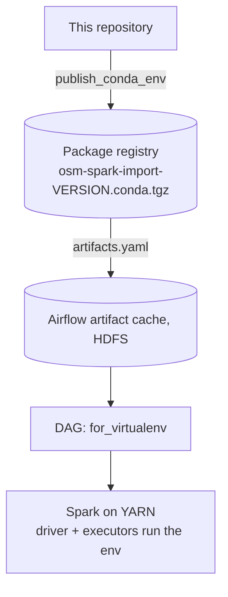

# Deploying on a Spark/YARN cluster

The Spark jobs ship the way other WMF data jobs do: the package and its
locked dependencies are built into a **conda env artifact** by the
[workflow_utils](https://gitlab.wikimedia.org/repos/data-engineering/workflow_utils)
CI templates, published to this project's GitLab package registry, declared in
[airflow-dags](https://gitlab.wikimedia.org/repos/data-engineering/airflow-dags),
and run with `SparkSubmitOperator.for_virtualenv`, which ships the env to the
driver and executors. YARN runs no Docker images; the env replaces the image.
The docker-compose setup stays for local development.



## The env

| File | |
|---|---|
| `conda-environment.yaml` | Python 3.10 (the version the WMF job guide recommends) |
| `requirements.txt` | `pyspark==3.5.3`: Spark comes with the env and matches the Iceberg runtime JAR |
| `constraints.txt` | the lock: every dependency pinned for Python 3.10 on linux x86_64, so the driver and every executor run the same versions. Regenerate with the command at its top after changing dependencies |
| `pyproject.toml` | the package; conda-dist installs it with `pip install .` |
| `bin/osm_spark_import_job.py` | installed as `bin/osm_spark_import_job.py` in the env: the PySpark application (it must end in `.py`); its arguments are those of `osm-spark-import` |

pyosmium, shapely and pyproj come as self-contained wheels (libosmium,
GEOS, PROJ data included), so the env needs nothing from the cluster's nodes
but a Linux with glibc.

## Releasing

`.gitlab-ci.yml` includes `conda_artifact_repo.yml` from workflow_utils
(pinned tag) and adds a `test` job (ruff, black, isort, pytest including the
Spark tests, in the artifact's Python with Java).

1. Once: create a project access token (role Maintainer, scopes `api` and
   `write_repository`) and store it as the masked CI variable
   `CI_PROJECT_PASSWORD`.
2. `main` stays on a `.dev` version (`pyproject.toml`, `.bumpversion.cfg`).
   To release, run the manual `trigger_release` job on `main`
   (`RELEASE_VERSION_BUMP=major|minor|patch`, default `minor`): it drops
   `.dev`, tags, and bumps to the next `.dev`.
3. The tag pipeline runs `publish_conda_env`, which uploads
   `osm-spark-import-VERSION.conda.tgz` to the package registry, and
   `publish_gitlab_release`. On other branches `publish_conda_env` is manual
   and publishes `VERSION-BRANCH`, for testing.

## airflow-dags

Declare the env and the Iceberg runtime JAR in the instance's
`config/artifacts.yaml`. The env's id is its package file's download URL,
from the package page of this project:

```yaml
artifacts:
  osm-spark-import-0.3.0.conda.tgz:
    id: https://gitlab.wikimedia.org/repos/<group>/osm-spark-import/-/package_files/<id>/download
  iceberg-spark-runtime-3.5_2.12-1.6.1.jar:
    id: org.apache.iceberg:iceberg-spark-runtime-3.5_2.12:1.6.1
    source: <the instance's Maven source>
```

A DAG per namespace. **Verify the `for_virtualenv` arguments against
current DAGs in airflow-dags** (`launcher`, `use_virtualenv_spark`, how JARs
are passed); this sketch follows the WMF Airflow guide:

```python
ENV = artifact("osm-spark-import-0.3.0.conda.tgz")
ICEBERG = artifact("iceberg-spark-runtime-3.5_2.12-1.6.1.jar")
OSM = {  # Settings: see README.md
    "OSM_MAPPING": "hdfs://analytics-hadoop/wmf/data/osm/mapping.yml",  # a path or URL
    "OSM_NAMESPACE": "planet",
    "OSM_STORAGE_ROOT": "hdfs://analytics-hadoop/wmf/data/osm",
    "OSM_BUCKETS": "256",
    "OSM_PARTITIONS": "4000",
}
CONF = {
    "spark.jars": ICEBERG,
    "spark.sql.extensions": "org.apache.iceberg.spark.extensions.IcebergSparkSessionExtensions",
    "spark.sql.catalog.osm": "org.apache.iceberg.spark.SparkCatalog",
    "spark.sql.catalog.osm.type": "hive",  # the cluster's catalog
    "spark.sql.shuffle.partitions": "4000",
    "spark.executor.pyspark.memory": "4g",  # decode and build run in Python
    **{f"spark.yarn.appMasterEnv.{k}": v for k, v in OSM.items()},
    **{f"spark.executorEnv.{k}": v for k, v in OSM.items()},
}


def job(task_id, *args):
    return SparkSubmitOperator.for_virtualenv(
        task_id=task_id,
        virtualenv_archive=ENV,
        entry_point="bin/osm_spark_import_job.py",
        application_args=list(args),
        launcher="skein",
        use_virtualenv_spark=True,
        conf=CONF,
    )


run = job("run", "run", "--max-diffs", "60")  # scheduled, e.g. hourly; never --loop on a cluster
maintain = job("maintain", "maintain")  # e.g. daily, between runs
```

`chunk` needs no Spark: run it once per import as a plain task of the same
env (e.g. a skein task) on a host with HDFS access, then `import`:

```sh
osm-spark-import chunk https://planet.openstreetmap.org/pbf/planet-latest.osm.pbf \
    hdfs://analytics-hadoop/wmf/data/osm/pbf/planet-YYMMDD --chunks 8000
osm-spark-import import hdfs://analytics-hadoop/wmf/data/osm/pbf/planet-YYMMDD
```

`hdfs://` URIs are written through libhdfs (pyarrow; needs `CLASSPATH` from
`hadoop classpath --glob`), or through WebHDFS when `OSM_WEBHDFS_URL` is set
(`OSM_WEBHDFS_KERBEROS=true` on a Kerberized cluster; install the
`kerberos` extra).

## Operating

- **Lock.** `import`, `rebuild`, `run` and `maintain` hold the namespace's
  lock. A failed task retried by Airflow is a new application: if the
  previous attempt was killed (not failed), its lock stays, and the retry
  fails until `osm-spark-import unlock` after checking that nothing runs.
  YARN application retries (same application ID) take the lock over.
- **Lag.** `osm-spark-import status` and `osm-spark-import-loader status`
  print JSON with `sequences_behind` and `seconds_behind`, for a sensor or
  an alert.
- **Loader.** A long-running process outside Spark (`osm-spark-import-loader
  apply --loop`, e.g. on Kubernetes with the docker image): the PG*
  variables (use `PGPASSFILE` or a secret), read and delete access to the
  outbox (it deletes batches no schema needs), and `OSM_EXPIRE_DIR` if
  tiles are expired.
- **Sizing.** See [design.md §7](design.md#7-scaling): chunk size against
  task memory, buckets and partitions, large relations, diff throughput.
