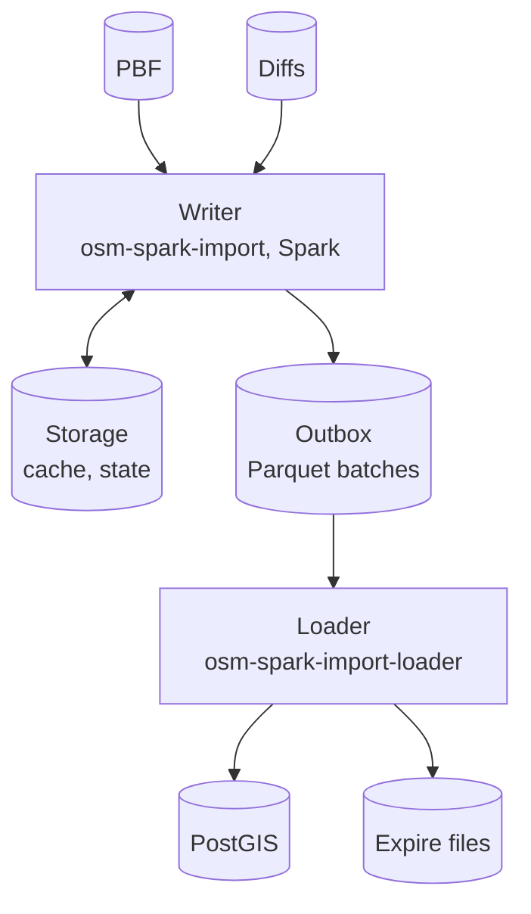
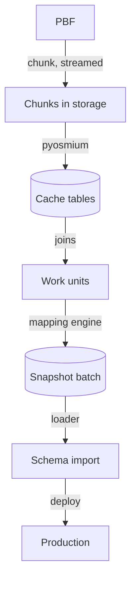
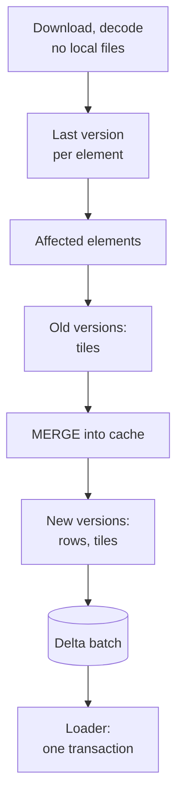
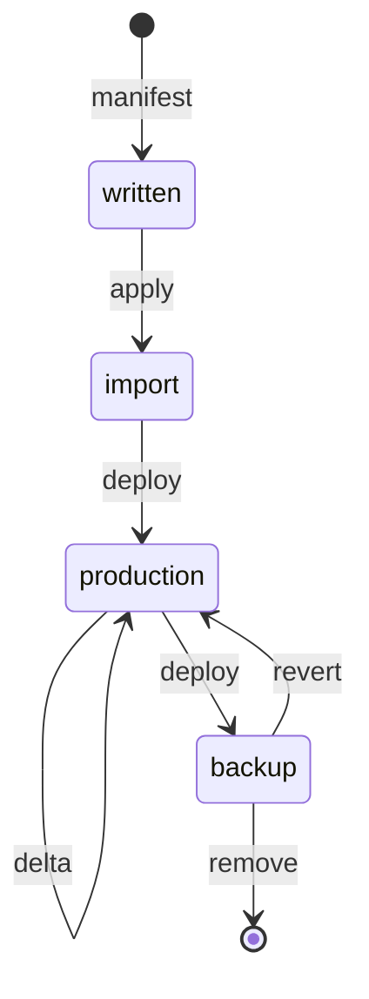
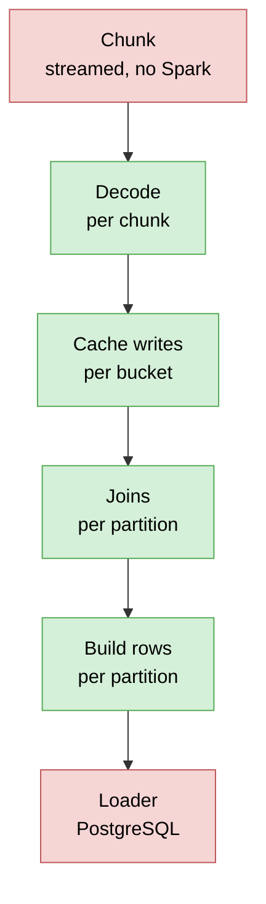

# osm-spark-import: design

Status: implemented for local development, 2026-11-14 (§6).

## 1. Goal

Load OpenStreetMap into PostgreSQL/PostGIS — tables defined by a mapping
file, generalized tables, an import/production/backup schema rotation,
replication diffs and expired tiles — with Spark doing the heavy work:
pyosmium for parsing, Iceberg and Parquet in shared storage for the cache and the
intermediate output, and a loader that streams batches into PostgreSQL.

## 2. Architecture



The writer and the loader only share the outbox: the writer never touches
the database, the loader never runs Spark.

## 3. The mapping engine

`osm_spark_import.mapping` turns elements into rows; the format is described in
[mapping.md](mapping.md).

| Module | |
|---|---|
| `config` | the mapping file: ordered mapping values (the first value that matches wins), repeated keys kept |
| `tags` | tag filters applied when elements are cached: `load_all` + `exclude` (fnmatch globs), or only the tags the mapping uses |
| `match` | matchers per table type: mapping values, `__any__`, filters, `areas`, relation types |
| `columns` | column values; each type has a value type that decides the PostgreSQL type |
| `geom` | projection (pyproj), geometries (shapely) |
| `writer` | rows of nodes, ways and relations; expired tiles |
| `expire` | tile lists (mercantile; adaptive zoom for long lines and large boxes) |
| `postgis` | the SQL: tables, generalization, indexes, rotation, diff updates |

Rules that decide the output:

- **Coordinates.** The cache keeps pyosmium's integers (1e-7 degrees), the
  same for PBF and change files; geometries are projected from them with
  pyproj.
- **Geometries.** Lines and polygons after removing consecutive duplicate
  nodes; every polygon is normalized; invalid polygons are repaired with
  `buffer(0)`; multipolygons: member ways snapped (gaps below 0.1 SRID
  units), merged into rings (`line_merge`) and combined with the even-odd
  rule.
- **Expired tiles.** Points: their tile and neighbours within 0.2 tiles;
  polygons: every tile of the bounding box, lines: every tile they cross, at
  the highest zoom where that is under 64 / 500 tiles.
- **Skipping.** A relation with a missing member way or coordinate is
  skipped; a way whose line cannot be built is skipped entirely; relation
  member rows stop at a member that fails.
- **IDs.** Ways keep their ID, relations are negated (or offset with
  `use_single_id_space`).

## 4. Data flow

### Import



`chunk` runs before the Spark job and without Spark: it streams the PBF from
its source (URL, local file, storage) straight into a storage directory, as
chunks of a chosen size, resuming after read errors and checking the MD5
(`--md5`, or `SOURCE.md5` as published next to planet files). A chunk is the
PBF header blob plus a run of data blobs: a valid PBF file on its own.
`_chunks.json`, written last, records the source, MD5, chunk sizes and the
replication sequence to continue from: from the PBF's timestamp (pyosmium's
`timestamp_to_sequence`) unless given. The import decodes one chunk per
task, so the chunk size is the unit of work: pick it from the memory of a
task (`--chunk-mb`) or from the cores (`--chunks`, 2–4 per core).

### Diffs



Every affected element is rebuilt from the cache, so applying the final
state of several change files gives the same rows as applying them one by
one. Old versions are expired if they match a table and could be built
(relations cut off by an extract are not expired through their members);
new versions are expired if they were written.

### Batches

```
<OSM_STORAGE_ROOT>/outbox/<namespace>/<batch, 12 digits>/
    tables/<table>/*.parquet   columns in mapping order, + __id, __gen
    deletes/*.parquet          delta: (kind n/w/r, OSM ID)
    tiles/*.parquet            delta: expired tiles z/x/y
    _manifest.json             written last: table specs, generalized tables, srid, sequence
```

The loader needs no mapping file: the manifest carries the table specs.



## 5. Recovery

- **Writer.** A diff run is recorded in the writer state with the Iceberg
  snapshots of the cache tables before it changes them. On the next start
  (`run`, or `rebuild`): if the batch's manifest exists, the run completed;
  otherwise the cache is rolled back to the snapshots and the partial batch
  is removed. An interrupted import is simply run again. The state file is
  replaced atomically (rename with overwrite on HDFS, a single PUT on object
  stores).
- **Writer lock.** One writer per namespace: `import`, `rebuild`, `run` and
  `maintain` create `<root>/state/<namespace>.lock` exclusively (atomic on
  HDFS). A later attempt of the same Spark application (same application
  ID, e.g. a YARN retry) takes it over; anything else fails until
  `osm-spark-import unlock`.
- **Loader.** Its state row is written in the same transaction as the data,
  so it continues exactly where it stopped. Expired tiles are written
  before the commit, so a crash can repeat tiles but never lose them. An
  advisory lock allows one applying loader per namespace; `deploy` and the
  other commands wait for the batch being applied. With `--loop` it
  reconnects after database errors (with backoff) and takes the lock again.
- **Retention.** The loader deletes the outbox batches older than every
  batch a schema holds, after each change.

## 5a. Maintenance

The cache tables write diffs as delete files (merge-on-read) rather than
rewriting the data files of every bucket a diff touches. `maintain` (e.g.
daily, scheduled between runs; it takes the lock) compacts data and delete
files, expires snapshots older than `OSM_SNAPSHOT_RETENTION_HOURS` (keeping
the current one: recovery only needs the snapshots of the run in progress,
and maintenance never runs during one) and removes orphan files older than
three days.

## 6. Verification

| Check | Result |
|---|---|
| unit tests (mapping file, filters, matchers, columns, geometries, multipolygons, tile lists, chunking, settings, SQL, CSV, loader) | pass |
| Spark tests, local mode with Iceberg: chunk → import → a diff, compared with a fresh import of the newer data (cache tables, point and line rows; big-unit path on one side); a run crashing after the merge rolled back; lock; maintenance | pass |
| Andorra 2026-11-10 imported, diffs 4964–4967 applied, compared with Andorra 2026-11-13 imported (`osm-spark-import-compare`) | all 16 tables of the default mapping identical |
| a diff run killed while merging the cache, then run again | rolled back and redone; same tables |
| Luxembourg import (1.3 M rows, default mapping) | completes; 78 s on the local cluster |

```sh
CHK="-e OSM_NAMESPACE=check -e OSM_SCHEMA=check -e OSM_SCHEMA_IMPORT=check_import -e OSM_SCHEMA_BACKUP=check_backup"
GF=https://download.geofabrik.de/europe; PBF=hdfs://namenode:8020/osm/pbf
docker compose run --rm client sh -c "osm-spark-import chunk $GF/andorra-261110.osm.pbf $PBF/andorra-261110 && osm-spark-import import $PBF/andorra-261110"
docker compose run --rm client osm-spark-import-loader deploy
docker compose run --rm client osm-spark-import run --until 4967
docker compose run --rm $CHK client sh -c "osm-spark-import chunk $GF/andorra-261113.osm.pbf $PBF/andorra-261113 && osm-spark-import import $PBF/andorra-261113 && osm-spark-import-loader apply"
docker compose run --rm client osm-spark-import-compare public check_import
```

## 7. Scaling



Decoding, joins and row building scale with the cluster (planet: ~2,500
chunks of 32 MB; hundreds of buckets and partitions). The serial ends are
chunking (one sequential stream: about the time to download the PBF, done
once per import and outside the Spark job) and PostgreSQL (COPY,
generalization, indexes).

Sizing:

- **Chunks.** A decode task holds its chunk's elements as Arrow batches:
  give tasks several times the chunk size (`spark.executor.pyspark.memory` or
  memory overhead), and 2–4 chunks per core.
- **Buckets and partitions.** Planet: `OSM_BUCKETS` in the hundreds
  (`nodes` alone is ~9 billion rows) and `OSM_PARTITIONS` set explicitly; the
  default follows `spark.sql.shuffle.partitions`, not the executors present
  at start, which dynamic allocation makes arbitrary.
- **Large relations.** Coastlines, oceans and boundaries carry millions of
  coordinates in one work unit. Units above `OSM_BIG_UNIT_NODES` are
  repartitioned apart from the others and built one at a time; each is
  logged (executor log) with its size and build time, to size executor
  memory from.
- **Diff throughput.** A diff run has a fixed cost (about ten Spark stages,
  five Iceberg commits; a minute locally, more at planet scale) plus the
  work for the changed elements. A batch of `OSM_MAX_DIFFS` minutely diffs
  must finish within that many minutes, or replication falls behind for
  good: measure a planet run and raise `OSM_MAX_DIFFS`, or use hourly
  diffs. `status` reports the lag in sequences and seconds.

## 8. Limits

- Not supported: `limitto`-style clipping, geojson column types.
- Change files from a larger area than the import (e.g. planet diffs on an
  extract) are cached completely.
- `use_single_id_space`, `relation` tables and srid 4326 are implemented
  but not covered by end-to-end runs.
- Planet scale is untested; see §7. Dynamic partition pruning is disabled
  during diff runs (a Spark 3.5 failure on these Iceberg plans).
- `status` cache sizes come from snapshot summaries (no scan) and are
  approximate once delete files are compacted.
- The exclusive create behind the writer lock is atomic on HDFS; on object
  stores without conditional writes it is best effort.
