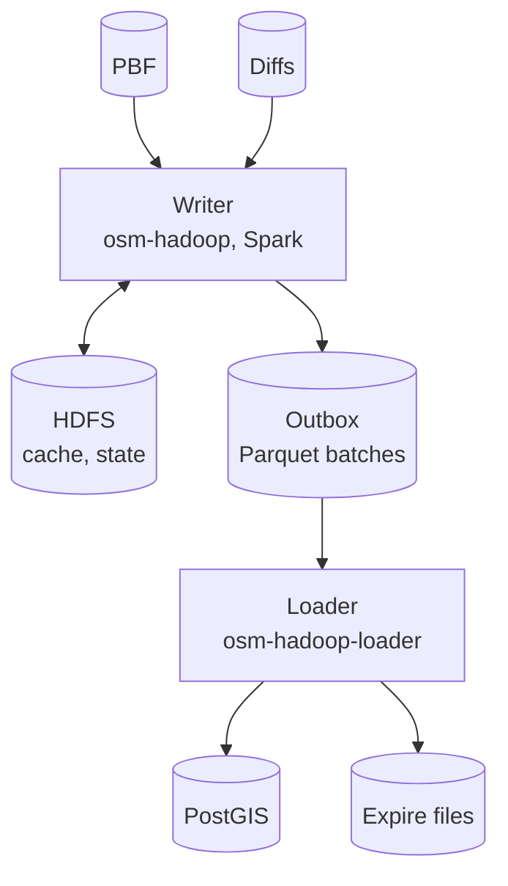
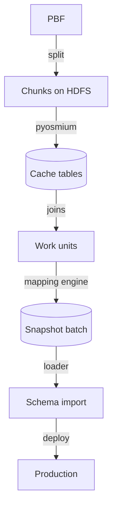
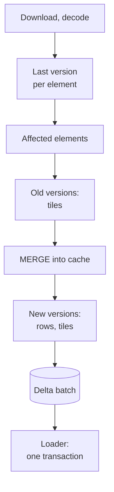
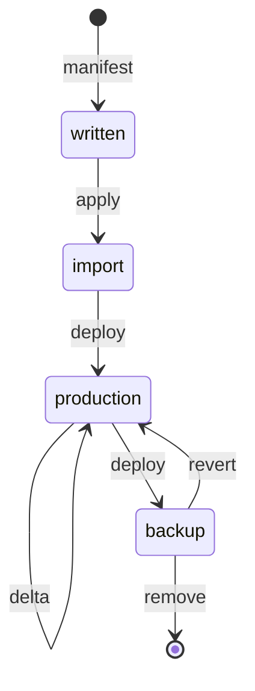
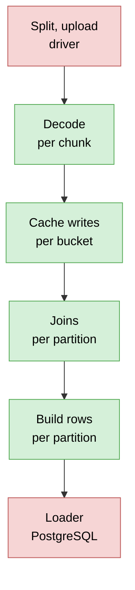

# osm-hadoop-import: design

Status: implemented for local development, 2026-11-14 (§6).

## 1. Goal

Load OpenStreetMap into PostgreSQL/PostGIS — tables defined by a mapping
file, generalized tables, an import/production/backup schema rotation,
replication diffs and expired tiles — with Hadoop doing the heavy work:
pyosmium for parsing, Iceberg and Parquet on HDFS for the cache and the
intermediate output, and a loader that streams batches into PostgreSQL.

## 2. Architecture



The writer and the loader only share the outbox: the writer never touches
the database, the loader never runs Spark.

## 3. The mapping engine

`osm_hadoop.mapping` turns elements into rows; the format is described in
[mapping.md](mapping.md).

| Module | |
|---|---|
| `config` | the mapping file: ordered mapping values (the first value that matches wins), repeated keys kept |
| `tags` | tag filters applied when elements are cached: `load_all` + `exclude` (globs), or only the tags the mapping uses |
| `match` | matchers per table type: mapping values, `__any__`, filters, `areas`, relation types |
| `columns` | column values; each type has a value type that decides the PostgreSQL type |
| `geom` | coordinates and geometries |
| `writer` | rows of nodes, ways and relations; expired tiles |
| `expire` | tile lists (adaptive zoom for long lines and large boxes) |
| `postgis` | the SQL: tables, generalization, indexes, rotation, diff updates |

Rules that decide the output:

- **Coordinates.** The cache keeps coordinates as uint32 values truncated
  from the parsed float (`1e-9 * nanodegrees` for PBF, the decimal text for
  change files); every geometry is built from them, so a diff and an import
  of the same data give the same coordinates.
- **Geometries.** Lines and polygons after removing consecutive duplicate
  nodes; every polygon is normalized (shell clockwise from its lowest point);
  invalid polygons are repaired with `buffer(0)`; multipolygons from member
  ways: ring merging, closing gaps below 0.1 (SRID units), area sort,
  containment for shells and holes.
- **Skipping.** A relation with a missing member way or coordinate is
  skipped; a way whose line cannot be built is skipped entirely; relation
  member rows stop at a member that fails.
- **IDs.** Ways keep their ID, relations are negated (or offset with
  `use_single_id_space`).

## 4. Data flow

### Import



A chunk is the PBF header blob plus a run of data blobs: a valid PBF file
on its own. The replication sequence to continue from is taken from the
PBF's timestamp (pyosmium's `timestamp_to_sequence`) unless given.

### Diffs



Every affected element is rebuilt from the cache, so applying the final
state of several change files gives the same rows as applying them one by
one. Old versions are expired if they match a table and could be built
(relations cut off by an extract are not expired through their members);
new versions are expired if they were written.

### Batches

```
<OSM_HDFS_ROOT>/outbox/<namespace>/<batch, 12 digits>/
    tables/<table>/*.parquet   columns in mapping order, + __id, __gen
    deletes/*.parquet          delta: (kind n/w/r, OSM ID)
    tiles/*.parquet            delta: expired tiles z/x/y
    _manifest.json             written last: table specs, generalized tables, srid, sequence
```

The loader needs no mapping file: the manifest carries the table specs.



## 5. Recovery

- **Writer.** A diff run is recorded in the writer state with the Iceberg
  snapshots of the cache tables before it changes them. On the next start:
  if the batch's manifest exists, the run completed; otherwise the cache is
  rolled back to the snapshots and the partial batch is removed. An
  interrupted import is simply run again.
- **Loader.** Its state row is written in the same transaction as the data,
  so it continues exactly where it stopped. Expired tiles are written
  before the commit, so a crash can repeat tiles but never lose them. An
  advisory lock allows one applying loader per namespace; `deploy` and the
  other commands wait for the batch being applied.

## 6. Verification

| Check | Result |
|---|---|
| unit tests (mapping file, filters, matchers, columns, geometries, multipolygons, ring merging, tile lists, PBF splitting, SQL, CSV) | 196 pass |
| Andorra 2026-11-10 imported, diffs 4964–4967 applied, compared with Andorra 2026-11-13 imported (`osm-hadoop-compare`) | all 16 tables of the default mapping identical |
| a diff run killed while merging the cache, then run again | rolled back and redone; same tables |
| Luxembourg import (1.3 M rows, default mapping) | completes; 78 s on the local cluster |

```sh
CHK="-e OSM_NAMESPACE=check -e OSM_SCHEMA=check -e OSM_SCHEMA_IMPORT=check_import -e OSM_SCHEMA_BACKUP=check_backup"
docker compose run --rm client osm-hadoop import /data/work/downloads/andorra-261110.osm.pbf
docker compose run --rm client osm-hadoop-loader deploy
docker compose run --rm client osm-hadoop run --until 4967
docker compose run --rm $CHK client sh -c 'osm-hadoop import /data/work/downloads/andorra-261113.osm.pbf && osm-hadoop-loader apply'
docker compose run --rm client osm-hadoop-compare public check_import
```

## 7. Scaling



Decoding, joins and row building scale with the cluster (planet: ~2,500
chunks of 32 MB; hundreds of buckets and partitions). The serial ends are
splitting and uploading the PBF on the driver, and PostgreSQL (COPY,
generalization, indexes). Diff runs have about a minute of fixed cost (Spark
jobs, five Iceberg commits) and a scan of the reference index that should be
pruned to the changed IDs.

## 8. Limits

- Not supported: `limitto`-style clipping, geojson column types.
- Change files from a larger area than the import (e.g. planet diffs on an
  extract) are cached completely.
- `use_single_id_space`, `relation` tables and srid 4326 are implemented
  but not covered by end-to-end runs.
- Planet scale is untested; see §7. Dynamic partition pruning is disabled
  for diff runs (a Spark 3.5 failure on these Iceberg plans).
