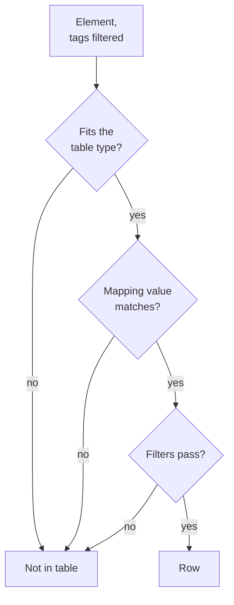

# The mapping file

YAML or JSON. It defines the tables, which OSM elements go into them, their
columns, generalized tables and how tags are filtered.
[mappings/default.yml](../mappings/default.yml) is a complete example.

```yaml
tags:
  load_all: true
  exclude: [note, "note:*", source, "source:*"]
areas:
  area_tags: [building, landuse, leisure, natural, aeroway, amenity]
  linear_tags: [highway, barrier]
tables:
  roads:
    type: linestring
    mapping:
      highway: [__any__]
      railway: [rail, tram]
    columns:
      - {name: osm_id, type: id}
      - {name: way, type: geometry}
      - {name: kind, type: mapping_value}
      - {name: name, key: name, type: string}
      - {name: z_order, type: wayzorder}
generalized_tables:
  roads_gen0:
    source: roads
    tolerance: 50.0
    sql_filter: kind IN ('motorway', 'trunk')
```

## How elements are matched



| Table type | Elements |
|---|---|
| `point` | nodes |
| `linestring` | open ways; closed ways unless `area=yes` |
| `polygon` | closed ways unless `area=no`; multipolygon and boundary relations |
| `relation`, `relation_member` | relations |
| `geometry` | all of the above, through `type_mappings` |

- **Values.** `key: [value, ...]`; `__any__` as value matches any value,
  `__any__: [__any__]` matches every tagged element. Values must be strings
  (quote `"yes"`, `"2"`).
- **One match per table** (and sub-mapping): if several tags match, the
  value listed first in the file wins; it is the matched key/value seen by
  `mapping_key`, `mapping_value`, `enumerate` and `wayzorder`. With
  `__any__: [__any__]` the matched key and value are `__any__`.
- **`mappings`**: named sub-mappings in one table; an element matching
  several sub-mappings gets one row per sub-mapping.
- **`type_mappings`** (`points`, `linestrings`, `polygons`): for `geometry`
  tables, which take any element type.
- **`areas`**: closed ways matched on a key in `area_tags` are not lines
  (unless `area=no`); ways matched on a key in `linear_tags` are not
  polygons (unless `area=yes`). The check uses the matched key, so it does
  not apply to `__any__` matches.
- **`filters`**: `require` / `reject` (`key: [values]`, `__any__` for any
  value), `require_regexp` / `reject_regexp` (`key: regexp`, unanchored),
  `exclude_tags` (`[[key, value], ...]`, same as `reject`).
- **`relation_types`**: relations need one of these `type` tags; polygon
  tables without it take `multipolygon`, `boundary` and `land_area`
  relations.

## Tags

With `tags.load_all: true` every tag is kept except `tags.exclude` (keys or
globs: `*`, `?`, `[...]`, as Python's `fnmatch`, case-sensitive). Otherwise only tags
the mapping uses are kept (mapping keys and values, column keys, filter
keys, `tags.include`, `area`, `type`). Filtering happens before matching,
so excluded tags never match and never appear in `hstore_tags`. Nodes and
relations without tags left are ignored.

## Columns

`- {name: ..., type: ..., key: ..., args: {...}, from_member: false}`

| Type | Value | PostgreSQL |
|---|---|---|
| `id` | element ID (ways as is, relations negated) | BIGINT |
| `geometry`, `validated_geometry` | the geometry; generalized tables of a `validated_geometry` column are made valid | GEOMETRY |
| `string` | tag `key` | VARCHAR |
| `bool` | tag `key`: false if empty, `0`, `false`, `no` | BOOL |
| `boolint` | as `bool`, 0/1 | SMALLINT |
| `integer` | tag `key` as 32 bit integer, else NULL | INT |
| `direction` | `1`/`yes`/`true` → 1, `-1` → -1, else 0 | SMALLINT |
| `mapping_key`, `mapping_value` | the matched key / value | VARCHAR |
| `hstore_tags` | all tags (`args.include`: only these keys) | HSTORE |
| `area`, `pseudoarea` | geometry area in SRID units, NULL if 0 | REAL |
| `webmerc_area` | area scaled by cos² of the latitude | REAL |
| `enumerate` | position (1-based) of the matched value (or of tag `key`) in `args.values`, else 0 | INT |
| `wayzorder` | layer × 10 + road rank (+7 for railways) ± 10 for bridge/tunnel; `args.ranks`/`args.default` for custom ranks | INT |
| `zorder` | rank from `args.ranks` (first = highest) of the matched value or tag `args.key` | INT |
| `string_suffixreplace` | tag `key` with suffixes replaced (`args.suffixes: {from: to}`) | VARCHAR |
| `categorize_int` | `args.values: {value: int}` for tag `key` or `keys`, else `args.default` | INT |
| `member_id`, `member_role`, `member_type`, `member_index` | relation member tables: the member's ID, role, type (0 node, 1 way, 2 relation), position | BIGINT, VARCHAR, SMALLINT, INT |

In `relation_member` tables, `from_member: true` takes a column's value from
the member (its tags and ID) instead of the relation.

## Tables in PostgreSQL

Each table gets a serial `id` (unless a column is named `id`), a primary key
of `id` and the `id`-type columns, the mapping's columns in order and the
geometry column (`POINT`, `LINESTRING`, or `GEOMETRY` for polygons and
relation members), a GiST index on the geometry. Rows: one per element and
table (relation member tables: one per member).

## Generalized tables

`source` (a table or another generalized table), `tolerance` (SRID units,
`ST_SimplifyPreserveTopology`) and an optional `sql_filter` (SQL on the
source's columns). They are created after the import, in dependency order,
and updated by diffs for the elements that changed.

## Other settings

- `use_single_id_space: true`: ways get negative IDs and relations
  `-1e17 - id`, so nodes, ways and relations never share an ID.
- SRID: `OSM_SRID` (3857 or 4326), not part of the file.
